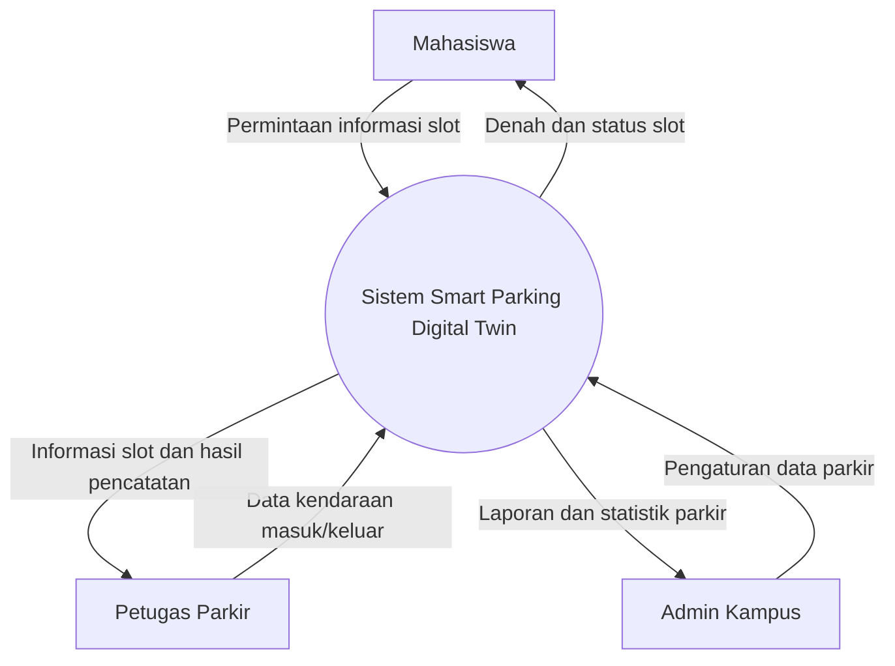

## 1. System Boundary dan External Entities

### System Boundary
Sistem yang dibahas adalah **Smart Parking Digital Twin Kampus**, yaitu sistem untuk menampilkan denah parkir, memantau ketersediaan slot, mencatat kendaraan masuk dan keluar, serta mengelola data parkir.

### External Entities
1. **Mahasiswa** — melihat denah dan ketersediaan slot parkir.
2. **Petugas Parkir** — mencatat kendaraan masuk dan keluar.
3. **Admin Kampus** — mengelola data slot dan melihat laporan parkir.

## 2. Context Model

- **Dipublikasikan:** ulasan disetujui dan dapat dilihat pengguna lain.
- **Ditolak:** ulasan tidak disetujui dan perlu diperbaiki sebelum dikirim kembali.
