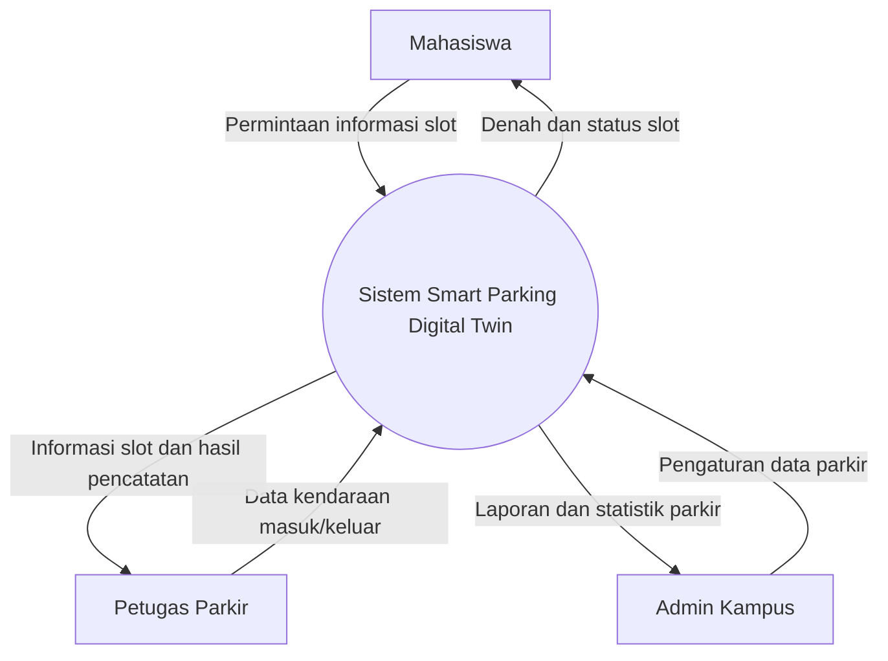
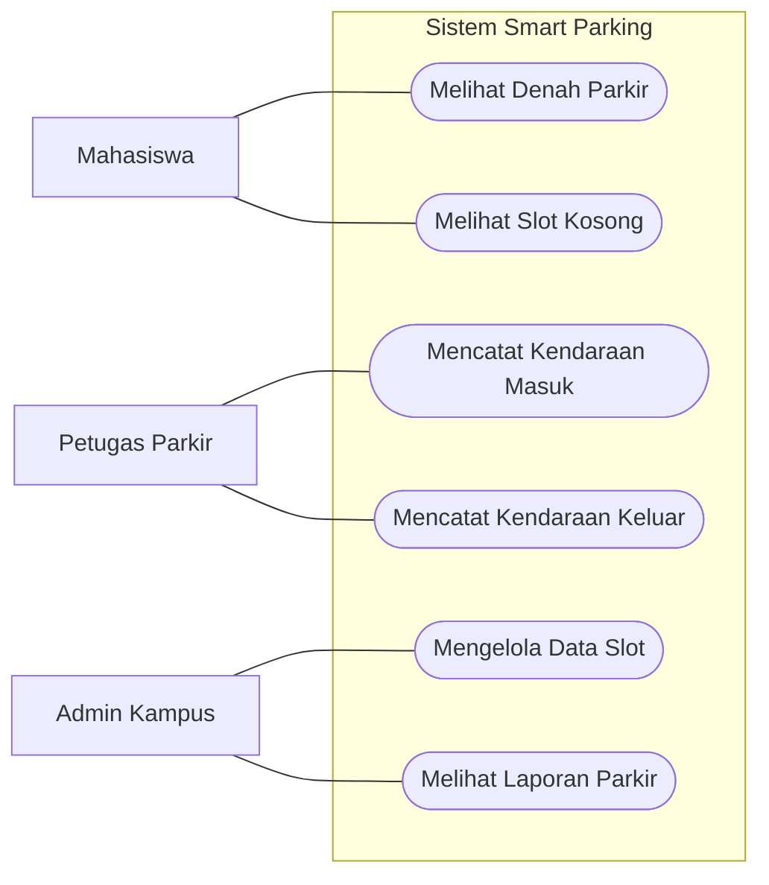
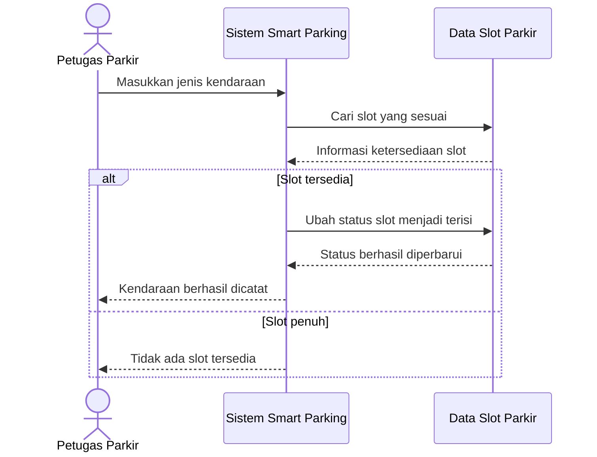
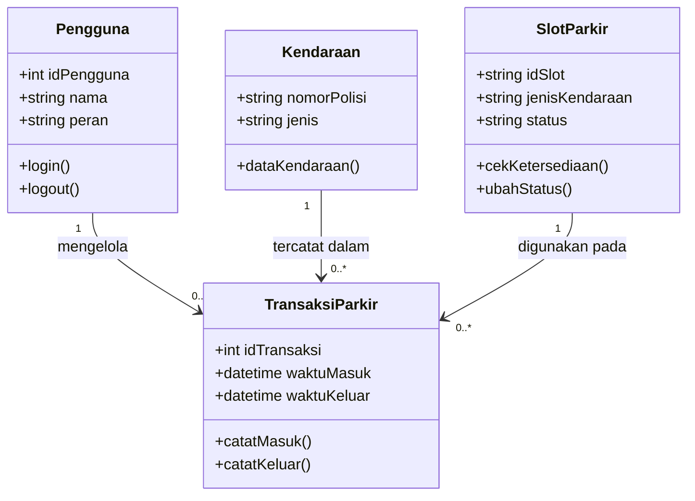
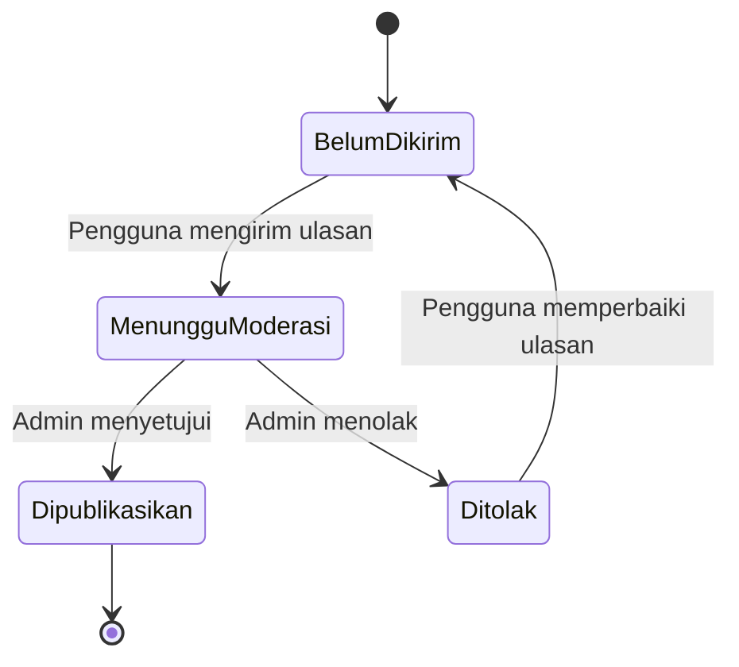

# Tugas Kelompok Rekayasa Perangkat Lunak (RPL)

## 1. System Boundary dan External Entities

### System Boundary
Sistem yang dibahas adalah **Smart Parking Digital Twin Kampus**, yaitu sistem untuk menampilkan denah parkir, memantau ketersediaan slot, mencatat kendaraan masuk dan keluar, serta mengelola data parkir.

### External Entities
1. **Mahasiswa** — melihat denah dan ketersediaan slot parkir.
2. **Petugas Parkir** — mencatat kendaraan masuk dan keluar.
3. **Admin Kampus** — mengelola data slot dan melihat laporan parkir.

## 2. Context Model

## 3. Use Case Diagram

Aktor: Mahasiswa, Petugas Parkir, dan Admin Kampus.

## 4. Sequence Diagram

Use case yang dipilih: **Mencatat Kendaraan Masuk**.

## 5. Class Diagram

### Keterangan Class
- **Pengguna:** menyimpan informasi pengguna sistem.
- **Kendaraan:** menyimpan nomor polisi dan jenis kendaraan.
- **SlotParkir:** menyimpan identitas slot dan status kosong atau terisi.
- **TransaksiParkir:** menyimpan waktu kendaraan masuk dan keluar.

## 6. State Diagram

State diagram berikut menggambarkan status **Review/Ulasan Parkir**.

### Keterangan Status
- **Belum Dikirim:** pengguna belum mengirim ulasan.
- **Menunggu Moderasi:** ulasan menunggu pemeriksaan admin.
- **Dipublikasikan:** ulasan disetujui dan dapat dilihat pengguna lain.
- **Ditolak:** ulasan tidak disetujui dan perlu diperbaiki sebelum dikirim kembali.
